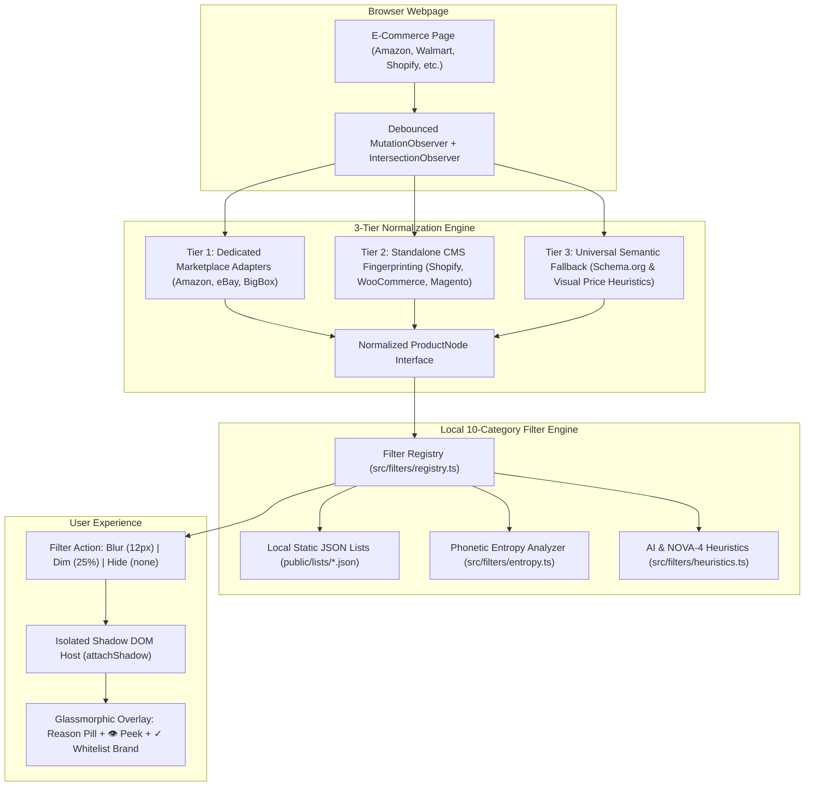

# 🛡️ Blurify: Universal Ethical & Slop Filter for E-Commerce

<p align="center">
  
</p>

<p align="center">
  <strong>Take back your shopping cart from AI slop, dropshippers, predatory ads, and corporate exploitation.</strong>
</p>

<p align="center">
  <a href="https://opensource.org/licenses/MIT"></a>
  <a href="https://developer.chrome.com/docs/extensions/mv3/intro/"></a>
  <a href="https://developer.apple.com/safari/extensions/"></a>
  
  <a href="https://github.com/Khaledykhalil/anti-ai-amazon-shopping-cart/pulls"></a>
</p>

---

## ⚡ The 1-Sentence Value Proposition

> **Blurify** is an open-source, cross-browser extension that automatically detects and applies optical blur, dimming, or hiding to AI-generated photography, white-label dropship junk, monopoly house brands, BDS & human-rights boycott targets, ultra-processed food additives, and predatory sponsored search ads across Amazon, eBay, Walmart, Shopify, and any store.

---

## 🏗️ Architecture & How It Works

Blurify operates entirely on-device with **<5ms main-thread overhead**, combining an asynchronous 3-Tier Adapter Pipeline with an isolated Shadow-DOM rendering overlay:



---

## 🎯 The 10 Opt-In Filter Categories

Every category is opt-in, fully customizable, and supports 3 action modes: **Blur** (frosted shield + reason pill), **Dim** (30% opacity), or **Hide** (`display: none`).

| Filter | Icon | Detection Signals & Mechanics | Real-World Target Examples |
| :--- | :---: | :--- | :--- |
| **BDS & Ethical Boycotts** | 🍉 | Sub-brand to parent conglomerate mappings, verified citations, settlement supply lines | SodaStream, Sabra, Ahava, Puma, HP, Carrefour, Siemens, AXA |
| **AI Slop & Imagery** | 🤖 | Prompt leakage markers (`--ar`, `unreal engine`, `8k`), synthetic skin/cloth textures, formulaic KDP book subtitles | Generic AI-generated apparel models, KDP AI self-published guides |
| **Alphabet-Soup Dropshippers** | 📦 | Shannon entropy analysis, 0-vowel ratios, unpronounceable consonant clusters, factory prefixes | `ZXQWTY`, `VBNKL`, `QWRTYP`, `B09X-PRO`, `SZ-Direct` |
| **Sponsored Ads** | 📢 | Marketplace sponsored tokens, hidden `sp-sponsored-result` flags, promoted carousel slots | Sponsored Amazon search cards, Walmart Promoted listings |
| **Monopoly House Brands** | 🏢 | Retailer private labels that clone and undercut independent small businesses | Amazon Basics, Solimo, Great Value, Onn, Good & Gather, Kirkland |
| **Ultra-Fast Fashion** | 👗 | Disposable garments, 100% virgin-synthetic microplastics, toxic dye effluents | Shein, Temu, Romwe, Fashion Nova, Boohoo, PrettyLittleThing |
| **Forced Labor Watchlist** | ⛓️ | CBP Withhold Release Orders, DOL findings, ASPI forced labor supply lines | Xinjiang cotton originations, coercive overseas dispatch labor |
| **Non-Cruelty-Free** | 🐇 | Parent corporations conducting animal testing for foreign regulatory compliance | L'Oréal, Estée Lauder, P&G, Johnson & Johnson, Colgate-Palmolive |
| **Ultra-Processed Foods** | 🧪 | NOVA Group 4 markers: High-Fructose Corn Syrup, Red 40, Yellow 5, hydrogenated oils | Synthetic candy, mass-market cereal bars, hydrogenated snacks |
| **Low Trust & NSFW** | 🔞 | Severe review drop-offs (<3.2 stars), review velocity anomalies, adult keyword shield | Dropshipped counterfeits, explicit adult items on family accounts |

---

## 🛒 Supported Shopping Platforms

- **Tier 1 (Out-of-the-Box Dedicated Adapters):**
  - Amazon (`.com`, `.co.uk`, `.ca`, `.de`, `.fr`, `.it`, `.es`, `.co.jp`, `.in`, `.com.au`)
  - eBay (`.com`, `.co.uk`, `.ca`, `.de`, `.fr`)
  - Walmart, Target, Best Buy, Etsy, Costco, Home Depot, Lowe's, Wayfair
  - Temu, AliExpress, Shein
- **Tier 2 (Automatic Standalone Store Fingerprinting):**
  - All Shopify Stores (`cdn.shopify.com`, `meta[name="shopify-digital-wallet"]`)
  - WooCommerce Stores (`body.woocommerce`, `.wc-block-grid__product`)
  - Magento, BigCommerce, Squarespace Commerce
- **Tier 3 (Universal Semantic Fallback):**
  - Any custom e-commerce website using Schema.org `Product` microdata, JSON-LD graphs, or repeating visual card patterns.

---

## ⏱️ Add a Brand in 30 Seconds (No Coding Required)

Blurify's filter lists are completely transparent and editable directly on GitHub:

1. Open [`public/lists/`](public/lists/) in your browser.
2. Select the list you want to update (e.g. [`boycotts.json`](public/lists/boycotts.json) or [`environment.json`](public/lists/environment.json)).
3. Click the **✏️ Edit (pencil icon)** button.
4. Add the brand entry:
   ```json
   {
     "brand": "BrandName",
     "parent": "Parent Conglomerate",
     "aliases": ["SubBrand A", "SubBrand B"],
     "reason": "Neutral explanation with factual citation.",
     "citation": "https://credible-source.org/report"
   }
   ```
5. Click **Propose changes** to submit your Pull Request!

---

## 💻 Local Development & Build

Blurify is built with **[WXT](https://wxt.dev/)**, **TypeScript**, **React 19**, and **Tailwind CSS**.

### Setup
```bash
# Clone the repository
git clone https://github.com/Khaledykhalil/anti-ai-amazon-shopping-cart.git blurify
cd blurify

# Install dependencies
npm install

# Start development with Hot Module Replacement
npm run dev
```

### Building for Cross-Browser Stores
```bash
# Build for Chrome (Manifest V3)
npm run build:chrome
# Output directory: .output/chrome-mv3

# Build for Firefox (MV2/MV3)
npm run build:firefox
# Output directory: .output/firefox-mv2

# Build for Safari (macOS & iOS)
npm run build:safari
# Output directory: .output/safari-mv2

# Package store ZIPs for upload
npm run zip:chrome
npm run zip:firefox
```

### Running Tests & Verification
```bash
# Run Vitest test suite (entropy, heuristics, brand matching)
npm test

# Run TypeScript compilation
npm run compile
```

---

## 🔒 Privacy & Store Compliance Guarantee

- **Zero Remotely Hosted Code:** Blurify does not use `eval()`, `new Function()`, or dynamic `<script>` loading.
- **Zero Telemetry:** No analytics, no logging endpoints, no tracking pixels, and no external network queries.
- **Shadow DOM Isolation:** Blurify controls are encapsulated in Shadow Roots (`attachShadow({ mode: 'open' })`) to prevent conflicts with checkout flows.

For full disclosures, see [PRIVACY_POLICY.md](PRIVACY_POLICY.md) and [STORE_SUBMISSION_GUIDE.md](STORE_SUBMISSION_GUIDE.md).

---

## 📄 License

Blurify is open-source software licensed under the [MIT License](LICENSE).
